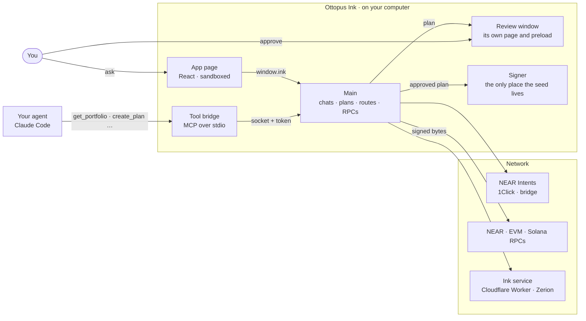

<div align="center">


<h1>Ottopus Ink</h1>

<p><strong>Every crypto move, one ask away.</strong></p>

<p>
A desktop wallet for Mac and Linux, driven by the agent already on your computer.<br />
Ask it to pay, swap or send. It works out which wallet, chain and asset to use,<br />
NEAR Intents carries it across chains, and Ink's review window shows you the exact bytes.<br />
<em>The agent proposes. You sign. Your keys never leave your computer.</em>
</p>

<p>
<a href="https://ink.ottopus.xyz">Website</a> ·
<a href="https://x.com/rajkoshik/status/2121727647701254646">Demo video</a> ·
<a href="https://github.com/ottopusxyz/ottopus-ink/releases/latest">Download</a> ·
<a href="#how-it-works">How it works</a> ·
<a href="#architecture">Architecture</a> ·
<a href="#run-it-locally">Run it locally</a> ·
<a href="#contributing">Contributing</a>
</p>

<p>
<a href="https://github.com/ottopusxyz/ottopus-ink/actions/workflows/ci.yml"></a>
<a href="https://github.com/ottopusxyz/ottopus-ink/releases/latest"></a>

<a href="LICENSE"></a>
</p>

<p>Built at the <strong>NEAR hackathon</strong>. <a href="https://x.com/rajkoshik/status/2121727647701254646">Watch the demo</a>.</p>

<a href="https://x.com/rajkoshik/status/2121727647701254646"></a>

</div>

## Why

Agents run our daily work, but they haven't made our crypto life any easier. One payment can still mean choosing a wallet, finding a chain with enough of the right token, bridging, swapping and pasting addresses by hand.

Ottopus Ink hands that work to the agent you already use. Ask for an outcome, such as "pay this invoice", and the agent reads what you hold and proposes a plan. Ink builds the exact transactions, routes them through [NEAR Intents](https://near.org/intents) when the token or chain changes, and shows you every byte in its own review window before anything is signed.

The agent never gets a key. It can read and propose; signing happens in a separate process on your computer, and only after you approve.

## How it works

1. **Set up a wallet.** Make a new recovery phrase or restore one, and pick a password. The seed is encrypted on your computer and only ever decrypted in Ink's signer process.
2. **Meet your agent.** Ink finds the coding agent you already have and are signed in to, and starts each chat locked to Ink's own tools: no shell, files or web.
3. **Ask.** *"Pay this invoice"*, with the PDF attached. The agent reads it, checks your balances on every chain, and proposes a plan. Ink builds it, finds the route, and opens the review window: a money map of what leaves where and what lands where, every fee, and each transaction decoded from its bytes. You approve with a real click, and Ink signs, sends and follows the money until it lands.

## Download

| You have | Download |
|---|---|
| A Mac with Apple Silicon (M1 or later) | `ottopus-ink-<version>-mac-arm64.dmg` |
| A Mac with an Intel chip | `ottopus-ink-<version>-mac-x64.dmg` |
| Ubuntu, Debian or another Debian-based Linux (Intel or AMD) | `ottopus-ink-<version>-linux-amd64.deb` |
| Any other 64-bit Linux (Intel or AMD) | `ottopus-ink-<version>-linux-x86_64.AppImage` |

Get them from the [latest release](https://github.com/ottopusxyz/ottopus-ink/releases/latest), with a `SHA256SUMS` file to check them against. The builds aren't signed with a developer certificate yet (the Mac app is ad-hoc signed), so the first launch needs a step or two: [docs/install.md](docs/install.md) has them.

Chats run on [Claude Code](https://claude.com/claude-code), so install it and sign in first. Ink finds it by itself.

> [!WARNING]
> Ink is a hackathon build. Nothing has been audited: don't give it a recovery phrase that holds more than you can afford to lose.

## Architecture



Main never holds a seed, the signer never touches the network, and the page only draws what main sends it. The agent reaches Ink through one MCP server, the tool bridge, which Ink's own binary runs in Node mode and which proves itself to main with a token made for that chat.

### Rules that never change

1. **No agent wallet.** The agent can read and propose. It has no tool that signs, approves or touches keys.
2. **The review window shows decoded bytes, not the agent's words.** The signer re-checks the plan hash before it signs.
3. **Keys stay on the device.** No Ottopus server, no custody.
4. **Each dependent step gets its own review** once its exact bytes are known.
5. **Chats started by the app are locked to Ottopus Ink tools,** with no shell, file or web access, unless you turn on an outside tool or skill in Settings. Each stays off until you agree in a dialog, and the chat then says it isn't Ottopus tools only. Ink can't see what an outside tool does: one that holds its own keys could move funds outside Ink's review. A remote server that needs a sign-in stays out of chats until you sign in from Settings. Ink keeps that sign-in encrypted and sends it only to that server's address, and the agent in a chat using the tool can read it while the chat runs.

### Who may touch what

| Path | Process | Trusted |
|---|---|---|
| `src/main` | Electron main: windows, IPC, agent drivers, plan engine | Yes |
| `src/preload` | The only bridge the renderer gets (`window.ink`) | Yes |
| `src/renderer` | React UI. Display only: no Node, sandboxed, strict CSP | No |
| `src/renderer/review.html`, `src/preload/review.ts` | The review window's own page and preload, the only place a plan is approved | Yes |
| `src/signer` | Separate utility process; the only place the decrypted seed lives | Yes |
| `src/shared` | Types and pure helpers used by more than one process | n/a |

The renderer may import only from `src/shared` and its own files; a lint rule enforces it.

**[docs/architecture.md](docs/architecture.md)** goes through each part in detail: the vault and its encryption, the accounts on each chain, the agent's tools, how a plan is hashed and moves between statuses, the review window's checks, the routes through NEAR Intents, and how each chain is signed and sent.

## Run it locally

You need Node 22.12 or newer (CI uses 24) on Linux or macOS, and [Claude Code](https://claude.com/claude-code) signed in to chat.

```bash
git clone https://github.com/ottopusxyz/ottopus-ink.git
cd ottopus-ink
npm ci
npm start          # the app in dev mode, with hot reload
```

Ink works on mainnet. Use a fresh recovery phrase and small amounts while you develop.

npm 11 runs only approved install scripts. Electron's, which downloads its binary, is approved in `package.json` under `allowScripts`.

On Linux, run `npm run desktop-entry` once to give a checkout its icon in the dock and app grid. GNOME on Wayland shows the icon of the desktop entry named after the app (`ottopus-ink.desktop`), which this writes to `~/.local/share/applications`, pointing at the checkout. It does nothing once the `.deb` is installed, because that ships its own entry with the same name and one in your home folder would hide it.

Useful commands:

```bash
npm test           # Vitest
npm run lint
npm run typecheck
npm run build      # production bundle in out/
npm run dist       # installers for this OS in dist/ (dist:linux or dist:mac for one)
```

CI runs lint, typecheck, tests and a build on Ubuntu and macOS for every pull request and on `main`.

### Packaging and releases

`npm run dist` packages with [electron-builder](https://www.electron.build) (config in `electron-builder.yml`): an AppImage and a `.deb` on Linux, and a `.dmg` for Apple Silicon and Intel on macOS, which can only be built on a Mac.

To publish a release, set `version` in `package.json` and push a matching tag (`v0.1.0`). The Release workflow builds every package, writes `SHA256SUMS`, and publishes a GitHub release with [docs/install.md](docs/install.md) as its notes. A tag with a suffix (`v0.2.0-beta.1`) becomes a prerelease, which the website skips.

### The website and the service

- [`site/`](site/README.md) is the landing page at [ink.ottopus.xyz](https://ink.ottopus.xyz): static files with no build step (`python3 -m http.server 4173 --directory site`). Its download buttons link the latest release's files.
- [`service/`](service/README.md) is the Ink service, a Cloudflare Worker that reads Zerion with Ottopus's key so the app ships none. It sees only public data, and Ink works without it.

## Project layout

```
src/
  main/          Electron main
    agents         finding agents, running Claude Code, Ink's skill
    mcp            the tool bridge and the tools the agent gets
    plans          the plan store, statuses, recipients, Activity
    review         the review window, decoding, input checks
    routes         NEAR Intents quotes, swaps and payments
    intents        deposit addresses, and watching them
    near, evm, solana   each chain's RPC and transaction building
    portfolio      balances and prices on every chain
    vault          the vault as main sees it
    external       outside MCP servers, skills and plugins
  preload/       window.ink, and the review window's own preload
  renderer/      the React app and the review page
  signer/        the signer process: vault crypto, keys, signing
  shared/        types and pure helpers: plans, transactions, chains
service/         the Ink service (Cloudflare Worker)
site/            the landing page
docs/            install steps, and how Ink works
scripts/         the desktop entry, and the README's hero
resources/       the app icon
build/icons/     Linux icons at each size
```

## Contributing

Issues and pull requests are welcome. [AGENTS.md](AGENTS.md) has the conventions in full; in short:

- **Read the rules first.** The [five rules](#rules-that-never-change) define the product, and the [layout table](#who-may-touch-what) says which process may touch what. A change that works around either needs to say so.
- **Branch from `main`** as `<type>/m<milestone>-<issue>-<slug>`, for example `feat/m2-60-receive-addresses`.
- **Commit small:** one feature or fix per commit, each building and passing on its own, with a type prefix such as `feat:`, `fix:`, `docs:`, `test:` or `refactor:`.
- **Describe the pull request** in two parts: a summary of what changed and why, and numbered manual tests someone can follow in `npm start`, including an edge case.
- **Run `npm run lint`, `npm run typecheck`, `npm test` and `npm run build`** before you open it, and add tests for anything that touches the vault, the signer, plan hashing or the review window.
- **Never commit secrets:** no API keys, real quote IDs or recovery phrases, not even in tests.

The hero at the top of this page is made by `python3 scripts/readme-hero.py` from the landing page's fonts, logos and colours. Run it again after changing them.

## Licence

[MIT](LICENSE)
